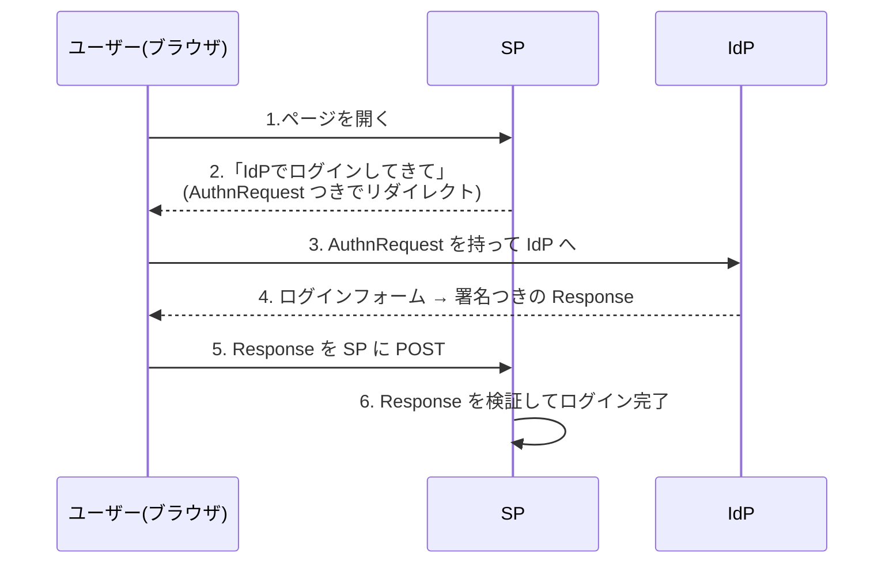

## はじめに

最近巷ではセキュリティという言葉が多く飛び交っていますね。  
昨今のサイバー攻撃を思うと当然です。私もいつ明日は我が身となってしまうのか毎日のように怯えています。
しかし、怯えるばかりでは何も守れません。正しい知識を身につけて正しく怯えたい。

そんなわけで(唐突)、応用情報を勉強してて見かけた「SAML」というSSOで使用されるプロトコルについて理解してみたくなりました。
臆病な私は昔から認証に対して過度な恐怖を抱えていたのでこの機会に！  
そこで

- セキュリティ勉強
- 資格勉強
- 恐怖克服(笑)

を掲げて、CSの知識すらままならないですがIdP、SPを自作してゼロからSAMLを実装していこう！ってな感じのブログになります。
実装言語はPythonを使います。(暗号ライブラリなどが豊富だし、言語取得で詰まりたくないので)

## 筆者のレベル感

- Pythonは基礎構文わかるぐらい。(学部生並)
- 暗号ライブラリなどは全く触ったことがない
- セキュリティ知識(CTFのWeb分野を少し解けるぐらい？)

認証基盤を実装するにはあまりに貧弱すぎるステータスなので、AIエージェント(Claude Code)や[SAML Core](https://docs.oasis-open.org/security/saml/v2.0/saml-core-2.0-os.pdf)を駆使して、都度わからない部分は調べていきます。
詳しい人から見ると、遠回りな説明もあると思いますが、自分ないしは誰かの助けになればと思い記録を残していきます。

> [!WARNING]
> このブログのコードは学習用です。SAML の自作は、それだけで脆弱性の原因になります。本番では実績のあるライブラリや IdP を使ってください。

## そもそもSAMLとは

ひとことでいうと、ログインを他のサービスに任せる仕組みです。

学校のアカウントでMoodleにログインするとき、Microsoftのログイン画面が出てきますよね。このときMoodleは私達のパスワードを受け取りません。Microsoftから「この人は確かにxx学校の○○だよ」という証明を受け取り、それを信じログインさせています。
この「ログインを他のサービスに任せる」仕組みを実現する方式の一つがSAMLです。(ただ、Microsoft系の連携ではOIDCを使うことが多い。)

以下に、登場人物をまとめます。

| 登場人物 | 役割 | 例 |
| - | - | - |
| ユーザー(ブラウザ) | ログインしたい人 | 🫵 |
| IdP(Identity Provider) | 本人確認をして、証明を発行する | Microsoft Entra ID, CloudGate UNO |
| SP(Service Provider) | 使いたいサービス。証明を受け取る | GitHub, Slack, Notion, Miro, Box |

### ログインの流れ



AuthRequestとか署名つきResponseなどまだよくわかってませんが、ユーザー(ブラウザ)を経由していることに目が行きます。
CTFを経験してきたこの私の脳が反射的に「改竄」という言葉を弾き出します笑。  
実際問題、ブラウザを経由させてやりとりするのは危険そうですよね。どうやら、この疑問こそがこのブログのテーマになりそうです。  
先にClaudeにネタバラシしてもらうと、IdPの**署名**とSPの**検証**が鍵を握っているそうです。

## ロードマップ

導入が終わったところで、このブログの着地点を決めます。
↓これを作る！


また、署名・検証が正しく機能しているか確かめるために攻撃用のスクリプトを書いて検証します。

Claudeに大体で下書きを書いてもらったので、以下の感じで進めていきたいと思っています。(あくまで目安です)

| 回 | タイトル | やること |
| --- | --- | --- |
| #0 | ロードマップ(この記事) | 全体像をつかむ |
| #1 | 署名ってなに? | 鍵ペアを作り、データに署名して検証する |
| #2 | 同じXMLなのにバイト列が違う問題 | XML の正規化(C14N) |
| #3 | 「この人はaliceです」という証明書を作る | Assertion を組み立てて署名する |
| #4 | 署名を確かめる | 署名を検証し、改ざんを見破る |
| #5 | IdPとSPをHTTPでつなぐ | 2つのサーバでログインを通す |
| #6 | 自分のSPを攻撃してみる | 検証のチェックを1つずつ足し、攻撃を防ぐ |
| #7 | 署名ラッピング:一番の落とし穴 | 署名を確かめたのに騙される攻撃 |
| #8 | ふりかえり:自作版と本物の差 | 本物のライブラリや IdP と比べる |

## 資料はこちら

コードは GitHub に置いています。
よければ、使ってみてください！

<https://github.com/fami-gb/saml-hands-on>

使うのは Python と `flask`、`cryptography` だけです。SAML のライブラリは使いません。

`start` タグが、関数の中身がすべて空になっている穴埋め版です。  
`main` タグがすべて穴埋めした状態の完成版です。

```sh
git clone https://github.com/fami-gb/saml-hands-on.git
cd saml-hands-on
git switch -c my-work start
uv run --with cryptography check.py
```

`check.py` は、最初に失敗したステップで止まります。

```
⏳ step1: 未実装 → Step 1: generate_keypair
```

## 各回の書き方

各回は次の形でまとめようと思います。

- **今回のゴール**: 1行と、確認方法
- **今回初めて出てくる言葉**: 3つまで
- **コード**: その回で埋める関数
- **動かしてみた**: 成功例と、わざと壊した失敗例
- **つまずいたこと**
- **まだわかっていないこと**

まだわかってないこと、には初歩的なことでも書くかもしれませんが、これもおのが成長のため、、！
